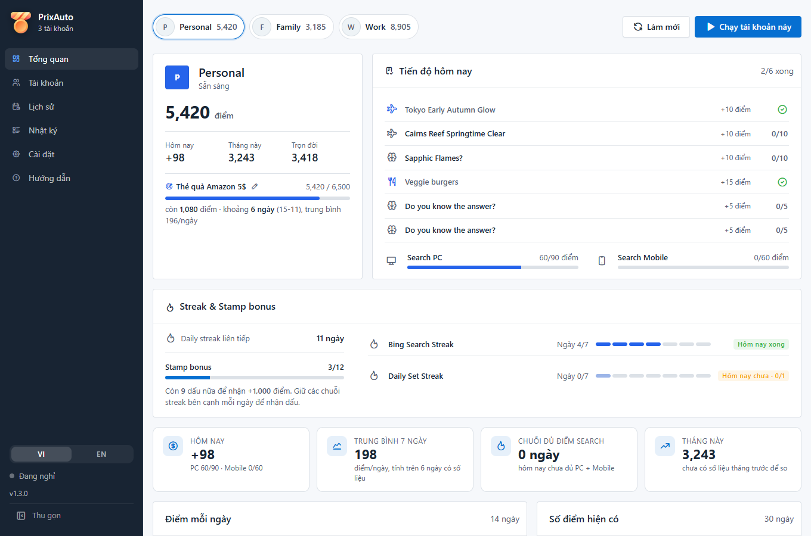
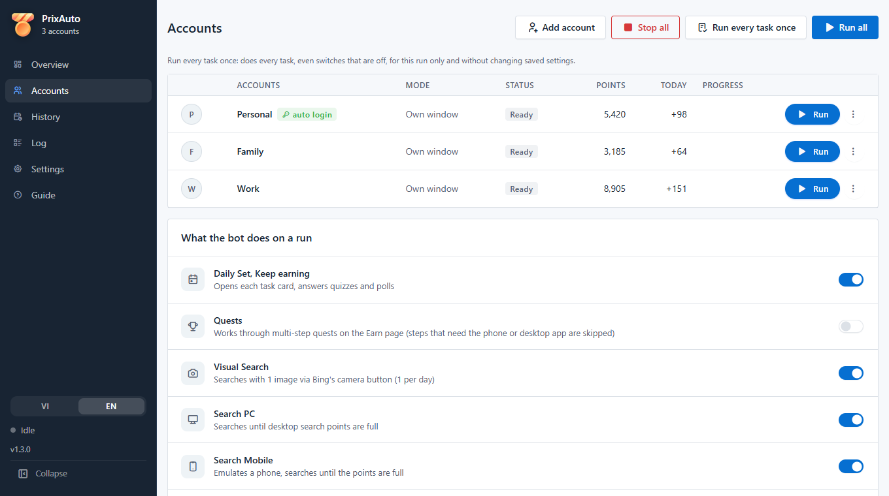
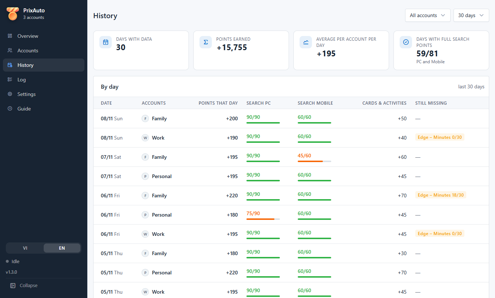
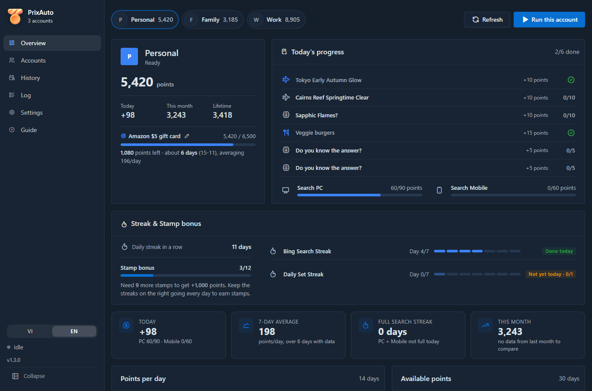
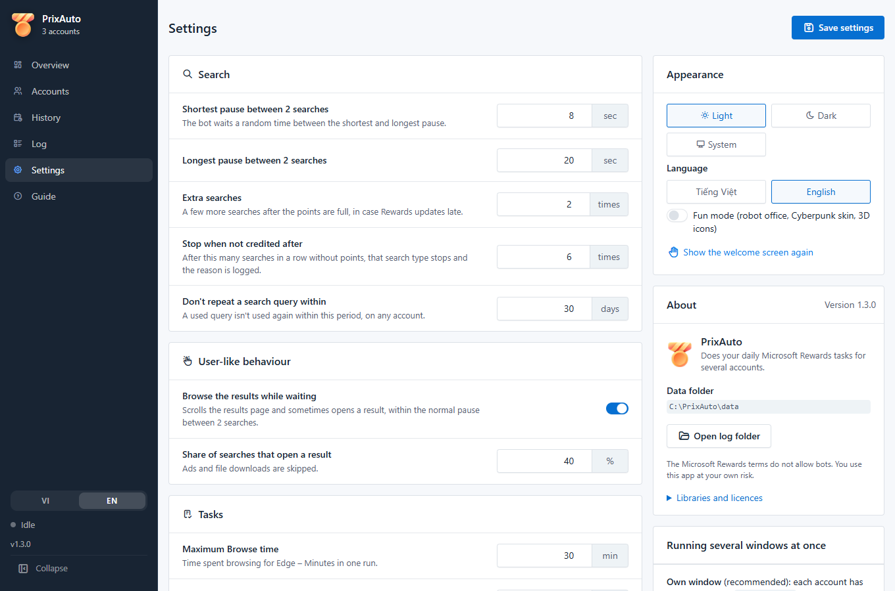

<div align="center">


# PrixAuto

**Tự làm các việc Microsoft Rewards hằng ngày cho nhiều tài khoản, trong một app trên máy tính.**

[](https://github.com/NT101-lc/reward-automation/releases/latest)
[](LICENSE)


Tiếng Việt · [English](README.en.md) · [Website](https://nt101-lc.github.io/reward-automation/vi/)



</div>

> [!WARNING]
> **Đọc trước khi dùng.** Điều khoản của Microsoft Rewards cấm dùng bot hay công cụ tự động để kiếm điểm. Microsoft
> có thể **khóa tài khoản Rewards, hủy điểm chưa đổi hoặc hủy quà đã đổi**. Dự án này không liên quan và không được
> Microsoft xác nhận. Bạn tự chịu mọi rủi ro khi dùng; đừng dùng với tài khoản mà bạn không muốn mất.

## Tính năng

- **Task hằng ngày**: Daily Set, Keep earning (link, poll, quiz cơ bản), Quests nhiều bước.
- **Search**: search PC và Mobile đến khi đủ điểm. Câu search lấy từ 22 lĩnh vực (khoảng 2.600 câu dài có nghĩa và
  10.000 từ khóa phổ biến), không trùng giữa các tài khoản và không lặp lại trong N ngày.
- **Visual Search** và **Browse** (Edge – Minutes) là việc thêm, bật tắt riêng. Browse lúc được lúc không, xem
  [câu hỏi thường gặp](#câu-hỏi-thường-gặp).
- **Nhiều tài khoản song song**, mỗi tài khoản một profile Edge và một cửa sổ riêng, giới hạn được số cửa sổ chạy cùng lúc.
- **Dashboard**: điểm, tiến độ hôm nay, streak và Stamp bonus, biểu đồ theo ngày, mục tiêu đổi quà kèm dự kiến số ngày,
  và lịch sử từng ngày: được bao nhiêu điểm, còn thiếu việc gì.
- **Kiểm tra** (không search): đăng nhập, tài khoản trên bing.com, Points breakdown, proxy; mỗi lỗi kèm cách sửa.
- **Tự đăng nhập lại** (không bắt buộc): mật khẩu mã hóa bằng Windows DPAPI, không bao giờ hiện ra hay ghi vào nhật ký.
  Gặp bước xác minh (mã, Authenticator, CAPTCHA) thì bot dừng, không cố vượt.
- **Chạy không cần mở cửa sổ** (`--run-all --headless`), để đặt lịch bằng Windows Task Scheduler hoặc cron.
- Giao diện sáng / tối, tiếng Việt / English, dùng được bằng bàn phím.

Chưa làm được: **check-in hằng ngày** (chỉ có trong app Microsoft Rewards trên điện thoại).

<table>
  <tr>
    <td></td>
    <td></td>
  </tr>
  <tr>
    <td></td>
    <td></td>
  </tr>
</table>

## Cài đặt trên Windows (không cần Python)

Bản tải về là một app chạy luôn, **không cần cài Python** hay bất cứ thứ gì khác. Chỉ cần:

- Windows 10 hoặc 11, bản 64-bit.
- **Microsoft Edge**: Windows 10/11 có sẵn, không cần làm gì.
- Một tài khoản Microsoft đã tham gia [Microsoft Rewards](https://rewards.bing.com).

### Bước 1: Tải app

1. Mở trang [bản phát hành mới nhất](https://github.com/NT101-lc/reward-automation/releases/latest).
2. Kéo xuống mục **Assets**, bấm vào file có đuôi **`-win64.zip`** để tải về.
   Không tải *Source code (zip)*: đó là mã nguồn, không chạy được nếu không có Python.

### Bước 2: Giải nén

1. Mở thư mục **Downloads**, **chuột phải** vào file zip vừa tải → **Extract All...** (Giải nén tất cả).
2. Ở ô đường dẫn, gõ `C:\PrixAuto` rồi bấm **Extract**.

> [!IMPORTANT]
> - **Phải giải nén ra**, đừng nhấp đúp mở file zip rồi chạy luôn trong đó: app sẽ không lưu được tài khoản.
> - Nên để ở `C:\PrixAuto`. **Không** để trong `C:\Program Files` (app không ghi được dữ liệu) và **không** để trong
>   Desktop / Documents nếu máy bật OneDrive (cookie đăng nhập sẽ bị đồng bộ lên mạng).

### Bước 3: Mở app

1. Vào `C:\PrixAuto`, nhấp đúp **`PrixAuto.exe`**.
2. Lần đầu Windows có thể hiện màn hình xanh **"Windows protected your PC"**. Đó là vì app chưa mua chữ ký số, không
   phải virus. Bấm **More info** (Thông tin thêm) → **Run anyway** (Vẫn chạy).
3. Nếu phần mềm diệt virus xóa hoặc chặn file, thêm thư mục `C:\PrixAuto` vào danh sách ngoại lệ rồi giải nén lại.

Màn hình chào sẽ hỏi ngôn ngữ, cho bạn đọc và đồng ý phần rủi ro, rồi thêm tài khoản đầu tiên.

### Bước 4: Đăng nhập (mỗi tài khoản một lần)

1. Vào trang **Tài khoản**. Ở dòng tài khoản, bấm nút **⋮** → **Đăng nhập**.
2. Một cửa sổ Edge mở ra với 2 tab. Ở tab **Rewards**, đăng nhập tài khoản Microsoft như bình thường.
3. Chuyển sang tab **bing.com**, nhìn góc trên bên phải: phải là **cùng tài khoản** vừa đăng nhập. Nếu chưa, bấm
   đăng nhập ở đó.
4. **Đóng cửa sổ Edge đó.** App sẽ ghi nhớ đăng nhập, lần sau không phải làm lại.

Có nhiều tài khoản thì bấm **Thêm tài khoản** và làm lại bước này cho từng tài khoản.

### Bước 5: Kiểm tra và chạy

1. Bấm **⋮** → **Kiểm tra**. Bot tự kiểm tra (không search) và ghi kết quả vào trang **Nhật ký**: dòng nào **FAIL**
   thì có kèm cách sửa.
2. Bấm **Chạy** ở một dòng, hoặc **Chạy tất cả**. Một lượt chạy thường mất khoảng 20–40 phút mỗi tài khoản vì bot
   search chậm như người thật. Trong lúc chạy cứ dùng máy bình thường, chỉ đừng đóng cửa sổ Edge của bot.

Mọi dữ liệu (tài khoản, phiên đăng nhập, cài đặt, lịch sử) nằm trong thư mục `data\` cạnh `PrixAuto.exe`.

## Chạy tự động mỗi ngày

App chưa có nút hẹn giờ. Bạn dùng **Task Scheduler** có sẵn của Windows để nó tự mở bot mỗi ngày (không hiện cửa sổ):

1. Bấm **Start**, gõ `Task Scheduler`, mở nó.
2. Bên phải bấm **Create Basic Task...**. Đặt tên, ví dụ `PrixAuto`, bấm **Next**.
3. Chọn **Daily** → **Next** → chọn giờ chạy (ví dụ 9:00 sáng, lúc máy thường đang bật) → **Next**.
4. Chọn **Start a program** → **Next**, rồi điền:
   - **Program/script**: bấm **Browse...** và chọn `C:\PrixAuto\PrixAuto.exe`
   - **Add arguments**: `--run-all --headless`
   - **Start in**: `C:\PrixAuto`
5. **Next** → tick **Open the Properties dialog...** → **Finish**.
6. Trong cửa sổ Properties, tab **Settings**, tick **Run task as soon as possible after a scheduled start is missed**
   (để nếu đúng giờ đó máy tắt thì lần bật máy sau sẽ chạy bù). Bấm **OK**.

Lưu ý: task chỉ chạy khi **cửa sổ app PrixAuto đang đóng** và máy đang bật, bạn đã đăng nhập Windows. Muốn thử ngay
thì chuột phải vào task → **Run**. Kết quả xem ở trang **Lịch sử** và **Nhật ký** khi mở lại app.

## Cập nhật

Khi có phiên bản mới (tag mới trên GitHub), app hiện một thanh thông báo ở trên cùng. Bấm **Xem thay đổi** để đọc danh sách
thay đổi, rồi **Cập nhật ngay**: app tải bản mới, kiểm tra mã SHA-256 rồi khởi động lại để cài. Tài khoản, cài đặt và
phiên đăng nhập được giữ nguyên. Tắt / bật tự kiểm tra hoặc bấm **Kiểm tra ngay** ở **Cài đặt → Giới thiệu**.

Cập nhật bằng tay: tải file zip mới rồi giải nén **đè lên** `C:\PrixAuto` (chọn *Replace* nếu Windows hỏi). Trong zip
không có thư mục `data\` nên tài khoản và phiên đăng nhập được giữ nguyên.

Từ bản cũ tên **RewardsBot**: chép thư mục `data\` cạnh `RewardsBot.exe` sang cạnh `PrixAuto.exe`, rồi sửa task trong
Task Scheduler sang `PrixAuto.exe`.

## Câu hỏi thường gặp

<details>
<summary><b>Mở app lên trắng trơn hoặc tắt ngay</b></summary>

App cần **Microsoft Edge WebView2 Runtime**. Windows 11 có sẵn; một số máy Windows 10 cũ chưa có. Tải bản
*Evergreen Bootstrapper* ở [trang WebView2 của Microsoft](https://developer.microsoft.com/microsoft-edge/webview2/),
cài rồi mở lại app. Nếu vẫn lỗi, xem file `data\crash.log` và gửi kèm khi báo lỗi.
</details>

<details>
<summary><b>Bấm đúp PrixAuto.exe không thấy gì</b></summary>

App chỉ mở một cửa sổ một lúc. Có thể app đang mở sẵn (xem thanh taskbar) hoặc đang chạy ngầm từ Task Scheduler. Đợi
lượt chạy ngầm xong hoặc tắt nó trong Task Manager rồi mở lại.
</details>

<details>
<summary><b>Search Mobile được 0 điểm</b></summary>

Chạy **Kiểm tra**. Tab bing.com phải đăng nhập cùng tài khoản với Rewards.
</details>

<details>
<summary><b>"Edge – Minutes" (30 phút duyệt web) mãi 0/30</b></summary>

Edge tự đo thời gian dùng trình duyệt rồi báo cho Rewards, và việc này hên xui: có hôm được, có hôm không. Thường phải
chạy Browse 3–4 lần trong ngày; khi đó tắt "Tự dừng" của Browse. Nhật ký ghi số phút trước và sau mỗi 10 phút.
</details>

<details>
<summary><b>Visual Search báo "Unable to process this search"</b></summary>

Bing chặn Visual Search khi một tài khoản thử nhiều lần trong ngày. Đợi hôm sau.
</details>

<details>
<summary><b>Bot báo profile đang được dùng</b></summary>

Còn một cửa sổ Edge đang mở profile của tài khoản đó. Đóng nó (hoặc dừng lượt chạy) rồi thử lại.
</details>

<details>
<summary><b>Nhật ký ở đâu? Báo lỗi thế nào?</b></summary>

`data\logs\<ngày>.log` (mặc định giữ 14 ngày). Trang **Nhật ký** có nút *Mở thư mục*. Bản exe không mở được thì xem
`data\crash.log`. Báo lỗi ở mục [Issues](https://github.com/NT101-lc/reward-automation/issues), gửi kèm file nhật ký
(xóa email nếu không muốn lộ). **Đừng bao giờ gửi cả thư mục `data\`**: trong đó có cookie đăng nhập.
</details>

## Bot làm việc thế nào

<details>
<summary><b>Cách mở trình duyệt</b></summary>

Ở chế độ **Cửa sổ riêng**, app mở Edge như một trình duyệt bình thường (vài cờ cần thiết, không có cờ tự động hóa,
`navigator.webdriver` = false) rồi điều khiển qua một cổng debug **chỉ trên 127.0.0.1**, giống cách Selenium làm. Mở bằng
cờ tự động hóa của Playwright thì Bing từ chối Visual Search. Ý tưởng lấy từ
[AutoRewarder](https://github.com/safarsin/AutoRewarder) (MIT).
</details>

<details>
<summary><b>Bot tự bảo vệ khi chạy</b></summary>

- Trước khi search, đối chiếu điểm trên bing.com với Rewards; **sai tài khoản thì không search**.
- Cứ 3 lượt search đọc lại điểm; nhiều lượt liên tiếp không được cộng (mặc định 6) thì dừng loại search đó và ghi lý do.
- **Search Mobile** chạy trong tab giả lập điện thoại Android (UA và client hints khớp phiên bản Edge đang chạy). Trước
  khi sang tab mobile, bot xóa cookie phiên search của Bing (`_Rwho`, `_SS`, `_EDGE_S`; không đụng cookie đăng nhập), vì
  Bing đánh dấu cả phiên là desktop sau lượt search PC đầu tiên và tính mọi search sau đó là PC.
- Giữa hai lượt search, bot cuộn trang kết quả và thỉnh thoảng mở một kết quả, trong đúng khoảng thời gian chờ (tắt được).
- Thẻ Daily Set / Keep earning được bấm đúng vị trí (kể cả hai thẻ trùng tên); thẻ làm xong mà chưa được ghi nhận thì
  làm lại một lần, vẫn chưa được thì ghi vào nhật ký.
- Trang Rewards tải chậm hoặc treo thì tải lại một lần trước khi báo lỗi.
- **Profile Edge cố định**: lần mở đầu bot ghim profile đang dùng vào `rewards_bot_profile.txt` và từ đó luôn mở đúng
  profile ấy. **Kiểm tra** báo nếu thư mục còn profile khác.
- Tài khoản có thư mục phiên đăng nhập cố định: đổi tên không phải đăng nhập lại.
</details>

<details>
<summary><b>Quests, Visual Search, Browse</b></summary>

- **Quests**: quest nhiều bước ở trang Earn ("5/6 tasks"), chạy sau Daily Set. Bước bị khóa sau app Microsoft Rewards
  trên máy tính hoặc điện thoại thì bỏ qua và ghi lý do.
- **Visual Search**: mỗi ngày một lượt: lấy ngẫu nhiên một ảnh trên Bing Images, bấm nút camera và tải ảnh lên. Bing
  chặn khi một tài khoản thử nhiều lần trong ngày, nên bot thử tối đa 4 lần mỗi ngày (chỉnh được).
- **Browse**: lướt trang tin tức / kiến thức tối đa N phút, nhắm tới "Edge – Minutes". Mặc định tắt. Thường phải chạy
  3–4 lượt trong ngày mới đủ 30/30 (khi đó nên tắt "Tự dừng"). Cứ 10 phút bot đọc lại Edge – Minutes, ghi vào nhật ký,
  dừng khi đủ hoặc khi 20 phút không tăng.
</details>

<details>
<summary><b>Câu search</b></summary>

Bot lấy câu search tiếng Anh từ 22 lĩnh vực:

- 21 lĩnh vực câu dài, có nghĩa (trung bình ~8 từ), ví dụ
  *how to set up nginx as a reverse proxy with ssl using lets encrypt*: IT (server & mạng, DevOps & cloud, IoT, bảo mật,
  lập trình, dữ liệu & AI), game, học thuật và đời sống. Sửa ở `rewards_bot/search/catalog.py`.
- 1 lĩnh vực **từ khóa phổ biến** (khoảng 10.000 từ khóa ngắn: phim, người nổi tiếng, xu hướng tìm kiếm), chiếm khoảng
  1/12 số lượt search. Sửa ở `rewards_bot/search/popular_queries.json`.

Hai câu liền nhau không cùng lĩnh vực, các tài khoản không tìm cùng một câu.
</details>

<details>
<summary><b>Hai cách chạy nhiều cửa sổ</b></summary>

- **Cửa sổ riêng** (nên dùng): mỗi tài khoản có thư mục `data/profiles/<tên>` riêng và một cửa sổ riêng. Có thể đặt
  proxy riêng cho từng tài khoản (`http`, `https`, `socks4`, `socks5`, không kèm mật khẩu).
- **Gắn vào Edge đang mở**: tự mở Edge với cổng debug, mỗi cửa sổ một cổng và một thư mục:
  ```bash
  msedge.exe --remote-debugging-port=9222 --user-data-dir="C:\EdgeRewards1"
  ```
  Đăng nhập trong cửa sổ đó, rồi thêm tài khoản chế độ "Gắn vào Edge đang mở" với cổng tương ứng.
</details>

## Riêng tư và bảo mật

- Mọi thứ nằm trên máy bạn. App không gửi số liệu sử dụng. Việc kiểm tra cập nhật chỉ đọc danh sách tag / bản phát hành công khai trên
  GitHub (tắt được ở Cài đặt). Trình duyệt của bot chỉ mở Bing,
  Rewards, và các trang mà Browse hoặc việc thỉnh thoảng mở một kết quả search đi tới.
- `data\` chứa cookie đăng nhập Microsoft. Trên Windows thư mục này được khóa quyền ngay lần chạy đầu (chỉ tài khoản
  Windows của bạn và SYSTEM đọc được). Đừng gửi nó cho ai.
- Mặc định trình duyệt chạy với `--no-proxy-server`, nên proxy hệ thống không chen giữa được (tắt trong Cài đặt nếu
  mạng của bạn bắt buộc đi qua proxy). HTTPS luôn kiểm tra chứng chỉ.
- Cửa sổ riêng mở Edge với cổng debug chỉ trên `127.0.0.1`, đóng cùng trình duyệt. Trong lúc đó chương trình khác trên
  cùng máy có thể điều khiển cửa sổ ấy, nên đừng chạy bot trên máy dùng chung.
- Giao diện có Content-Security-Policy chặt: chỉ chạy script của app, mọi thư viện nằm sẵn trong app (không tải từ CDN).

## Dành cho người muốn sửa code

Phần này chỉ cần nếu bạn muốn chạy từ mã nguồn hoặc phát triển thêm. Người dùng bình thường dùng bản zip ở trên là đủ.

<details>
<summary><b>Chạy từ mã nguồn trên Windows</b></summary>

1. Cài **Python 3.10 trở lên** từ [python.org/downloads](https://www.python.org/downloads/). Ở màn hình cài đặt đầu
   tiên, **tick ô "Add python.exe to PATH"** rồi bấm *Install Now*.
2. Lấy mã nguồn: bấm nút **Code → Download ZIP** trên trang GitHub rồi giải nén, hoặc nếu có Git:
   ```bash
   git clone https://github.com/NT101-lc/reward-automation.git
   ```
3. Mở thư mục mã nguồn, gõ `cmd` vào thanh địa chỉ của File Explorer rồi Enter để mở cửa sổ lệnh ngay tại đó. Cài thư viện:
   ```bash
   pip install -r requirements.txt
   ```
4. Mở app:
   ```bash
   python -m rewards_bot
   ```
   Hoặc nhấp đúp `scripts/run.bat`.

| Lệnh | Làm gì |
|---|---|
| `python -m rewards_bot` | Mở app (chỉ một cửa sổ một lúc) |
| `python -m rewards_bot --run-all --headless` | Chạy mọi tài khoản, không mở cửa sổ |
| `python -m rewards_bot --check` | Kiểm tra mọi tài khoản, không search |

Mặc định app dùng Edge có sẵn; muốn dùng Chromium của Playwright thì chạy `python -m playwright install chromium` rồi
chọn trong trang Cài đặt.
</details>

<details>
<summary><b>Linux</b></summary>

Bot và chế độ không giao diện chạy được trên Linux. Cần:

1. Python 3.10+ và `pip install -r requirements.txt`.
2. Một trình duyệt dòng Chromium: **Microsoft Edge** (`microsoft-edge-stable`, nên dùng), Google Chrome hoặc Chromium.
   Dùng Chrome/Chromium thì chọn trong trang Cài đặt.
3. Chỉ khi cần giao diện: bộ hiển thị web cho pywebview, GTK (`sudo apt install python3-gi gir1.2-webkit2-4.1`) hoặc Qt
   (`pip install "pywebview[qt]"`).

```bash
./scripts/run.sh
```
```bash
./scripts/run.sh --run-all --headless
```

Chạy hằng ngày bằng cron: `30 7 * * * cd /đường/dẫn/reward-automation && ./scripts/run.sh --run-all --headless`.
Trên Linux thư mục `data/` không tự khóa quyền (tự `chmod 700 data` nếu cần) và app không đọc proxy hệ thống.
</details>

<details>
<summary><b>Test và phát hành</b></summary>

```bash
pip install -r requirements-dev.txt
```
```bash
python -m pytest -q tests
```

Test giao diện vẽ mọi trang trong Edge chạy ẩn với API giả.

Phát hành: tăng `__version__` trong `rewards_bot/__init__.py`, rồi đẩy tag `v<phiên bản>`. GitHub Actions chạy test,
build `PrixAuto.exe` và đăng file zip kèm `.sha256`. Build trên máy: `python packaging/build_exe.py`.
</details>

<details>
<summary><b>Cấu trúc thư mục</b></summary>

```
rewards_bot/
├── __main__.py           điểm vào: giao diện, --run-all, --check
├── cli.py                --run-all / --check không mở cửa sổ
├── core/
│   ├── bot.py            một tài khoản: task, search, tự kiểm tra
│   ├── rewards_page.py   đọc rewards.bing.com (điểm, thẻ, Points breakdown)
│   ├── runner.py         chạy song song nhiều tài khoản, file nhật ký theo ngày
│   ├── edge_launcher.py  mở Edge bình thường với cổng debug nội bộ cho Playwright
│   ├── browser.py        tìm cửa sổ Edge còn giữ thư mục profile
│   ├── instance.py       khóa chỉ mở một app (data/app.lock)
│   ├── credentials.py    tự đăng nhập lại, mã hóa DPAPI
│   ├── security.py       quyền thư mục data, kiểm tra proxy và cổng debug
│   └── config.py         cài đặt và ghi JSON an toàn
├── search/               danh mục câu search và bảng chia câu không lặp
└── ui/                   app pywebview + giao diện web (Tabler, ApexCharts, có sẵn trong repo)
packaging/                build PyInstaller (PrixAuto.exe)
scripts/                  run.bat / run.sh (mở app), check.bat / check.sh (test)
tests/                    pytest: logic bot, đọc trang, API và test giao diện
docs/images/              ảnh chụp cho README
```
</details>

Đóng góp: cứ fork về phát triển thêm, gặp lỗi thì mở [issue](https://github.com/NT101-lc/reward-automation/issues).

## Giấy phép

PrixAuto phát hành theo [giấy phép MIT](LICENSE). Các thư viện đi kèm giữ giấy phép riêng (xem từng thư mục trong
`rewards_bot/ui/web/vendor/`): Tabler và Tabler Icons (MIT), ApexCharts (MIT), Fluent Emoji (MIT), Chakra Petch
(SIL OFL 1.1).

"Microsoft", "Bing", "Edge" và "Microsoft Rewards" là thương hiệu của Microsoft Corporation. Dự án này không liên quan
đến Microsoft.
