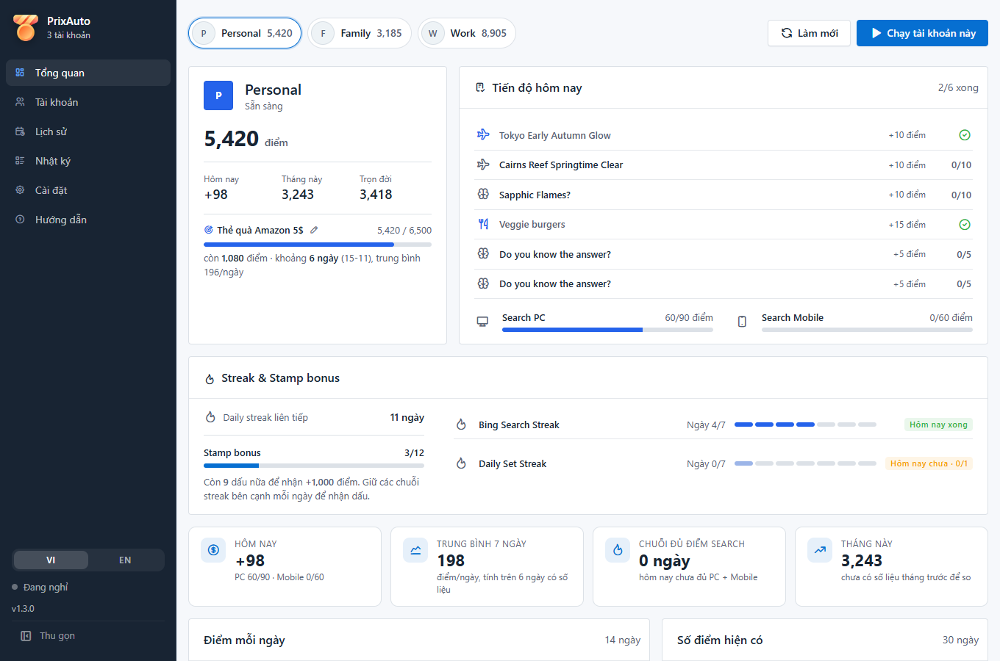
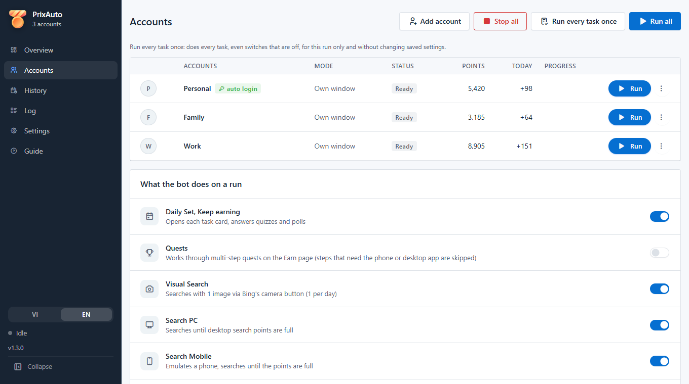
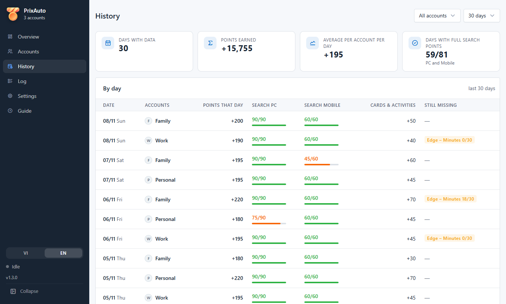
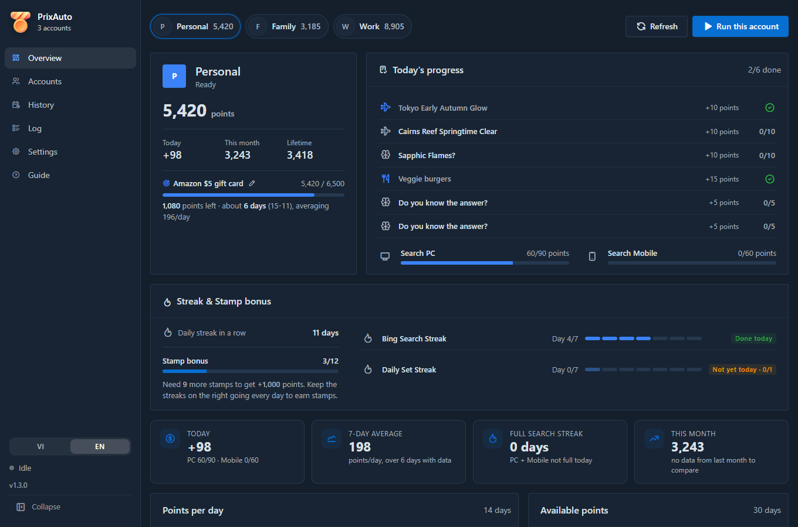
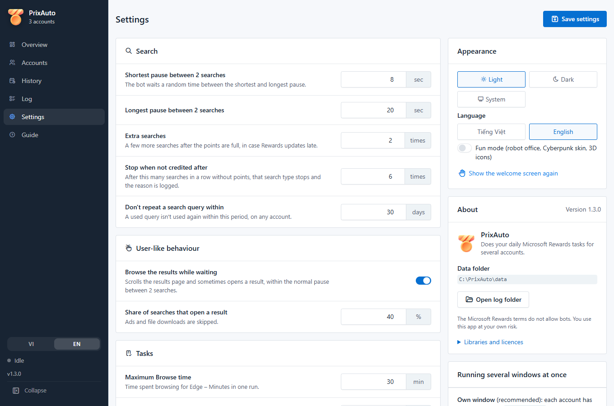

<div align="center">


# PrixAuto

**Tự làm các việc Microsoft Rewards hằng ngày cho nhiều tài khoản, trong một app trên máy tính.**

[](https://github.com/NT101-lc/reward-automation/releases/latest)
[](LICENSE)


[English](README.md) · Tiếng Việt



</div>

> [!WARNING]
> **Đọc trước khi dùng.** Điều khoản của Microsoft Rewards cấm dùng bot hay công cụ tự động để kiếm điểm. Microsoft
> có thể **khóa tài khoản Rewards, hủy điểm chưa đổi hoặc hủy quà đã đổi**. Dự án này không liên quan và không được
> Microsoft xác nhận. Bạn tự chịu mọi rủi ro khi dùng; đừng dùng với tài khoản mà bạn không muốn mất.

## Tính năng

- **Task hằng ngày**: Daily Set, Keep earning (link, poll, quiz cơ bản), Quests nhiều bước.
- **Search**: search PC và Mobile đến khi đủ điểm, câu search tự nhiên từ 21 lĩnh vực (khoảng 2.600 câu, không trùng
  giữa các tài khoản và không lặp lại trong N ngày).
- **Visual Search** và **Browse** (Edge – Minutes) là việc thêm, bật tắt riêng.
- **Nhiều tài khoản song song**, mỗi tài khoản một profile Edge và một cửa sổ riêng, giới hạn được số cửa sổ chạy cùng lúc.
- **Dashboard**: điểm, tiến độ hôm nay, streak và Stamp bonus, biểu đồ theo ngày, mục tiêu đổi quà kèm dự kiến số ngày,
  và lịch sử từng ngày: được bao nhiêu điểm, còn thiếu việc gì.
- **Kiểm tra** (không search): đăng nhập, tài khoản trên bing.com, Points breakdown, proxy; mỗi lỗi kèm cách sửa.
- **Tự đăng nhập lại** (không bắt buộc): mật khẩu mã hóa bằng Windows DPAPI, không bao giờ hiện ra hay ghi vào nhật ký.
  Gặp bước xác minh (mã, Authenticator, CAPTCHA) thì bot dừng, không cố vượt.
- **Chạy tự động** bằng Windows Task Scheduler hoặc cron, không cần mở cửa sổ.
- Giao diện sáng / tối, tiếng Việt / English, dùng được bằng bàn phím.

<table>
  <tr>
    <td></td>
    <td></td>
  </tr>
  <tr>
    <td></td>
    <td></td>
  </tr>
</table>

## Bắt đầu nhanh (Windows)

1. Tải `PrixAuto-<phiên bản>-win64.zip` ở [bản phát hành mới nhất](https://github.com/NT101-lc/reward-automation/releases/latest).
2. Giải nén vào một thư mục cố định, ví dụ `C:\PrixAuto`, rồi chạy `PrixAuto.exe`. Máy cần có Microsoft Edge
   (Windows 10/11 có sẵn).
   Windows có thể báo *"Windows protected your PC"* vì file exe chưa ký số: bấm **More info → Run anyway**.
3. Màn hình chào hỏi ngôn ngữ, phần đồng ý rủi ro và tài khoản đầu tiên.
4. Trang **Tài khoản**: bấm **⋮ → Đăng nhập** một lần cho mỗi tài khoản. Cửa sổ trình duyệt mở ra: đăng nhập ở tab
   Rewards, xem tab **bing.com** góc phải phải là **cùng tài khoản**, rồi đóng cửa sổ.
5. Bấm **⋮ → Kiểm tra** để chắc mọi thứ ổn, rồi **Chạy** (một tài khoản) hoặc **Chạy tất cả**.

Mọi dữ liệu (tài khoản, phiên đăng nhập, cài đặt, lịch sử) nằm trong thư mục `data\` cạnh `PrixAuto.exe`.

## Chạy tự động mỗi ngày

Tạo một task trong **Windows Task Scheduler** chạy mỗi ngày một lần:

```bash
C:\PrixAuto\PrixAuto.exe --run-all --headless
```

Đặt *Start in* là `C:\PrixAuto`. Task chỉ chạy được khi cửa sổ app đang đóng. Kết quả xem ở trang **Lịch sử** và
**Nhật ký**.

## Chạy từ mã nguồn

```bash
git clone https://github.com/NT101-lc/reward-automation.git
```
```bash
cd reward-automation
```
```bash
pip install -r requirements.txt
```
```bash
python -m rewards_bot
```

| Lệnh | Làm gì |
|---|---|
| `python -m rewards_bot` | Mở app (chỉ một cửa sổ một lúc) |
| `python -m rewards_bot --run-all --headless` | Chạy mọi tài khoản, không mở cửa sổ |
| `python -m rewards_bot --check` | Kiểm tra mọi tài khoản, không search |

Trên Windows có thể nhấp đúp `run.bat`. Mặc định app dùng Edge có sẵn; muốn dùng Chromium của Playwright thì chạy
`python -m playwright install chromium` rồi chọn trong trang Cài đặt.

<details>
<summary><b>Linux</b></summary>

Bot và chế độ không giao diện chạy được trên Linux. Cần:

1. Python 3.10+ và `pip install -r requirements.txt`.
2. Một trình duyệt dòng Chromium: **Microsoft Edge** (`microsoft-edge-stable`, nên dùng), Google Chrome hoặc Chromium.
   Dùng Chrome/Chromium thì chọn trong trang Cài đặt.
3. Chỉ khi cần giao diện: bộ hiển thị web cho pywebview, GTK (`sudo apt install python3-gi gir1.2-webkit2-4.1`) hoặc Qt
   (`pip install "pywebview[qt]"`).

```bash
./run.sh
```
```bash
./run.sh --run-all --headless
```

Chạy hằng ngày bằng cron: `30 7 * * * cd /đường/dẫn/reward-automation && ./run.sh --run-all --headless`.
Trên Linux thư mục `data/` không tự khóa quyền (tự `chmod 700 data` nếu cần) và app không đọc proxy hệ thống.
</details>

## Cập nhật

App không tự cập nhật. Tải file zip mới rồi giải nén đè lên thư mục cũ: trong zip không có thư mục `data\` nên tài
khoản và phiên đăng nhập được giữ nguyên. Bản mã nguồn: `git pull`.

Từ bản cũ tên **RewardsBot**: chép thư mục `data\` cạnh `RewardsBot.exe` sang cạnh `PrixAuto.exe`, rồi sửa task trong
Task Scheduler sang `PrixAuto.exe`.

## Bot làm việc thế nào

<details>
<summary><b>Cách mở trình duyệt</b></summary>

Ở chế độ **Cửa sổ riêng**, app mở Edge như một trình duyệt bình thường (vài cờ cần thiết, không có cờ tự động hóa,
`navigator.webdriver` = false) rồi điều khiển qua một cổng debug **chỉ trên 127.0.0.1**, giống cách Selenium làm. Mở bằng
cờ tự động hóa của Playwright thì Bing từ chối Visual Search. Ý tưởng lấy từ
[AutoRewarder](https://github.com/safarsin/AutoRewarder) (MIT).
</details>

<details>
<summary><b>Bot tự bảo vệ khi chạy</b></summary>

- Trước khi search, đối chiếu điểm trên bing.com với Rewards; **sai tài khoản thì không search**.
- Cứ 3 lượt search đọc lại điểm; nhiều lượt liên tiếp không được cộng (mặc định 6) thì dừng loại search đó và ghi lý do.
- **Search Mobile** chạy trong tab giả lập điện thoại Android (UA và client hints khớp phiên bản Edge đang chạy). Trước
  khi sang tab mobile, bot xóa cookie phiên search của Bing (`_Rwho`, `_SS`, `_EDGE_S`; không đụng cookie đăng nhập), vì
  Bing đánh dấu cả phiên là desktop sau lượt search PC đầu tiên và tính mọi search sau đó là PC.
- Giữa hai lượt search, bot cuộn trang kết quả và thỉnh thoảng mở một kết quả, trong đúng khoảng thời gian chờ (tắt được).
- Thẻ Daily Set / Keep earning được bấm đúng vị trí (kể cả hai thẻ trùng tên); thẻ làm xong mà chưa được ghi nhận thì
  làm lại một lần, vẫn chưa được thì ghi vào nhật ký.
- Trang Rewards tải chậm hoặc treo thì tải lại một lần trước khi báo lỗi.
- **Profile Edge cố định**: lần mở đầu bot ghim profile đang dùng vào `rewards_bot_profile.txt` và từ đó luôn mở đúng
  profile ấy. **Kiểm tra** báo nếu thư mục còn profile khác.
- Tài khoản có thư mục phiên đăng nhập cố định: đổi tên không phải đăng nhập lại.
</details>

<details>
<summary><b>Quests, Visual Search, Browse</b></summary>

- **Quests**: quest nhiều bước ở trang Earn ("5/6 tasks"), chạy sau Daily Set. Bước bị khóa sau app Microsoft Rewards
  trên máy tính hoặc điện thoại thì bỏ qua và ghi lý do.
- **Visual Search**: mỗi ngày một lượt: lấy ngẫu nhiên một ảnh trên Bing Images, bấm nút camera và tải ảnh lên. Bing
  chặn khi một tài khoản thử nhiều lần trong ngày, nên bot thử tối đa 4 lần mỗi ngày (chỉnh được).
- **Browse**: lướt trang tin tức / kiến thức tối đa N phút, nhắm tới "Edge – Minutes". Mặc định tắt. Thường phải chạy
  3–4 lượt trong ngày mới đủ 30/30 (khi đó nên tắt "Tự dừng"). Cứ 10 phút bot đọc lại Edge – Minutes, ghi vào nhật ký,
  dừng khi đủ hoặc khi 20 phút không tăng.
</details>

<details>
<summary><b>Câu search</b></summary>

Bot tự sinh câu search tiếng Anh từ 21 lĩnh vực (trung bình ~8 từ, câu nào cũng có nghĩa), ví dụ
*how to set up nginx as a reverse proxy with ssl using lets encrypt*. Gồm IT (server & mạng, DevOps & cloud, IoT,
bảo mật, lập trình, dữ liệu & AI), game, học thuật và đời sống. Hai câu liền nhau không cùng lĩnh vực, các tài khoản
không tìm cùng một câu. Muốn thêm câu: sửa `rewards_bot/search/catalog.py`.
</details>

<details>
<summary><b>Hai cách chạy nhiều cửa sổ</b></summary>

- **Cửa sổ riêng** (nên dùng): mỗi tài khoản có thư mục `data/profiles/<tên>` riêng và một cửa sổ riêng. Có thể đặt
  proxy riêng cho từng tài khoản (`http`, `https`, `socks4`, `socks5`, không kèm mật khẩu).
- **Gắn vào Edge đang mở**: tự mở Edge với cổng debug, mỗi cửa sổ một cổng và một thư mục:
  ```bash
  msedge.exe --remote-debugging-port=9222 --user-data-dir="C:\EdgeRewards1"
  ```
  Đăng nhập trong cửa sổ đó, rồi thêm tài khoản chế độ "Gắn vào Edge đang mở" với cổng tương ứng.
</details>

## Câu hỏi thường gặp

<details>
<summary><b>Search Mobile được 0 điểm</b></summary>

Chạy **Kiểm tra**. Tab bing.com phải đăng nhập cùng tài khoản với Rewards.
</details>

<details>
<summary><b>"Edge – Minutes" mãi 0/30</b></summary>

Edge tự đo thời gian dùng trình duyệt rồi báo cho Rewards. Thường phải chạy Browse 3–4 lần trong ngày; khi đó tắt
"Tự dừng" của Browse. Nhật ký ghi số phút trước và sau mỗi 10 phút.
</details>

<details>
<summary><b>Visual Search báo "Unable to process this search"</b></summary>

Bing chặn Visual Search khi một tài khoản thử nhiều lần trong ngày. Đợi hôm sau.
</details>

<details>
<summary><b>Bot báo profile đang được dùng</b></summary>

Còn một cửa sổ Edge đang mở profile của tài khoản đó. Đóng nó (hoặc dừng lượt chạy) rồi thử lại.
</details>

<details>
<summary><b>Nhật ký ở đâu?</b></summary>

`data\logs\<ngày>.log` (mặc định giữ 14 ngày). Trang **Nhật ký** có nút *Mở thư mục*. Bản exe không mở được thì xem
`data\crash.log`. Khi báo lỗi, gửi kèm file nhật ký.
</details>

## Riêng tư và bảo mật

- Mọi thứ nằm trên máy bạn. App không gửi số liệu sử dụng và không kiểm tra cập nhật. Trình duyệt của bot chỉ mở Bing,
  Rewards, và các trang mà Browse hoặc việc thỉnh thoảng mở một kết quả search đi tới.
- `data\` chứa cookie đăng nhập Microsoft. Trên Windows thư mục này được khóa quyền ngay lần chạy đầu (chỉ tài khoản
  Windows của bạn và SYSTEM đọc được). Đừng gửi nó cho ai.
- Mặc định trình duyệt chạy với `--no-proxy-server`, nên proxy hệ thống không chen giữa được (tắt trong Cài đặt nếu
  mạng của bạn bắt buộc đi qua proxy). HTTPS luôn kiểm tra chứng chỉ.
- Cửa sổ riêng mở Edge với cổng debug chỉ trên `127.0.0.1`, đóng cùng trình duyệt. Trong lúc đó chương trình khác trên
  cùng máy có thể điều khiển cửa sổ ấy, nên đừng chạy bot trên máy dùng chung.
- Giao diện có Content-Security-Policy chặt: chỉ chạy script của app, mọi thư viện nằm sẵn trong app (không tải từ CDN).

## Phát triển

```bash
pip install -r requirements-dev.txt
```
```bash
python -m pytest -q tests
```

Test giao diện vẽ mọi trang trong Edge chạy ẩn với API giả. `CLAUDE.md` ghi kiến trúc và những điều đã kiểm chứng về
cách Bing / Rewards hoạt động; đọc trước khi sửa bot.

Phát hành: tăng `__version__` trong `rewards_bot/__init__.py`, rồi đẩy tag `v<phiên bản>`. GitHub Actions chạy test,
build `PrixAuto.exe` và đăng file zip kèm `.sha256`. Build trên máy: `python packaging/build_exe.py`.

## Giấy phép

PrixAuto phát hành theo [giấy phép MIT](LICENSE). Các thư viện đi kèm giữ giấy phép riêng (xem từng thư mục trong
`rewards_bot/ui/web/vendor/`): Tabler và Tabler Icons (MIT), ApexCharts (MIT), Fluent Emoji (MIT), Chakra Petch
(SIL OFL 1.1).

"Microsoft", "Bing", "Edge" và "Microsoft Rewards" là thương hiệu của Microsoft Corporation. Dự án này không liên quan
đến Microsoft.
